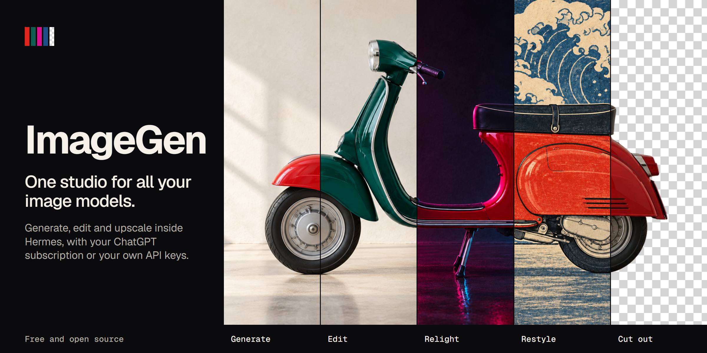
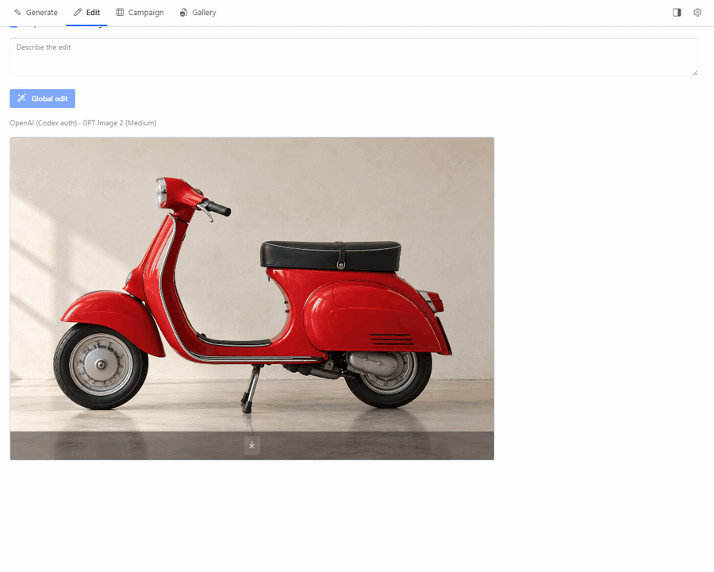
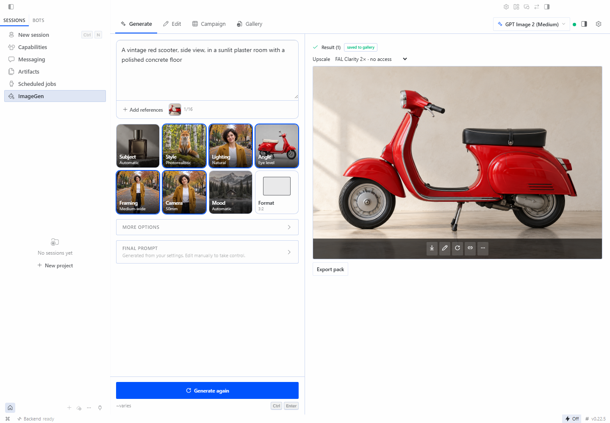
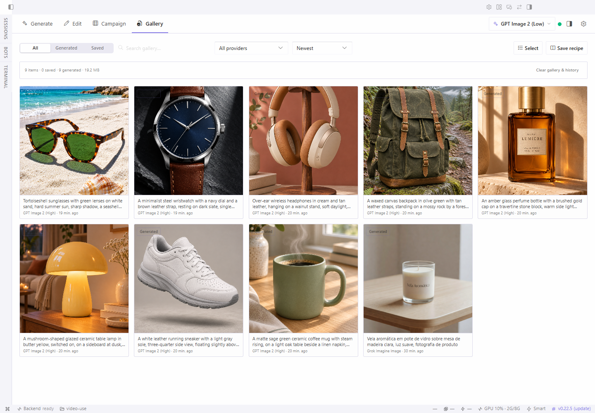
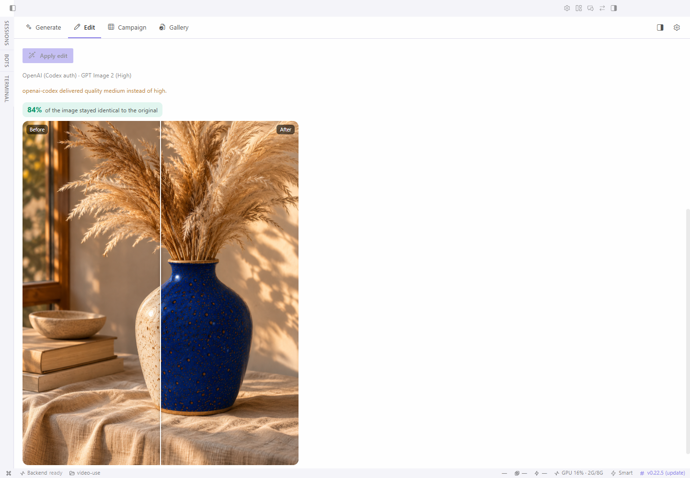
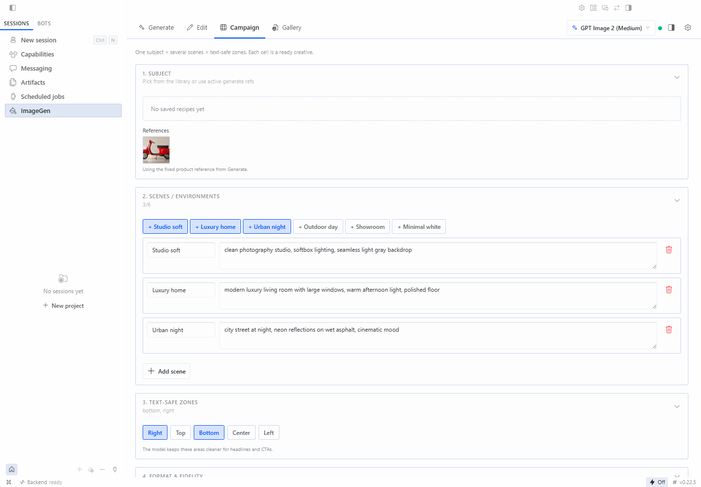
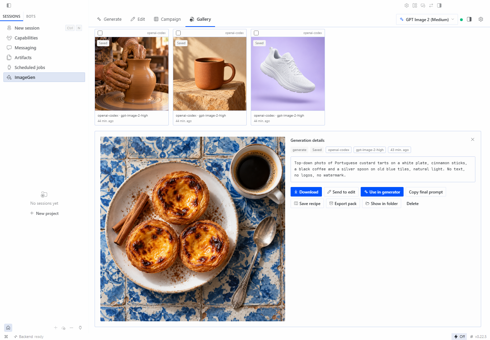
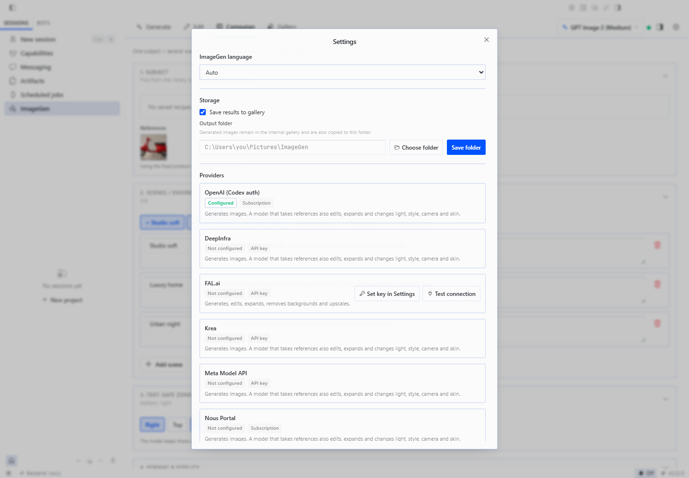

# ImageGen for Hermes Desktop



One studio for all your image models, inside Hermes Desktop. Generate, edit, relight,
restyle, cut out and run campaigns from one place, and keep every result in one gallery.
Use the ChatGPT subscription you already pay for, or any API key your Hermes profile has.

- **All your models in one form.** GPT Image on your subscription, FAL, Nous Portal,
  Magnific, Vertex AI, the Hermes image providers and an image server on your own machine. The form applies each model's real
  limits, and Settings says what each provider can do.
- **Direct with pictures, not jargon.** Style, light, angle, framing and camera are
  a row of chips. Open one to pick from photos of the same scene with that one change.
  The AI fills what you leave open, and each chip says whose choice it is.
- **Edit without losing quality.** Models redraw the whole picture on every edit,
  so an image gets softer each round. ImageGen puts back only the area that changed.
  The rest stays identical, pixel for pixel, after any number of edits. When you
  change the whole picture, it keeps the model's answer and tells you.
- **Campaigns and a gallery.** One product across several scenes in one batch. Every
  result keeps its prompt, model and settings, ready to reuse.
- **Works from any coding agent.** Claude Code, Codex or anything with a terminal can
  [generate a hundred images in one command](#use-it-from-coding-agents), and they land
  in the same gallery as yours.



## What it does

- **Generate** with FAL, Nous Portal, Magnific, Vertex AI and the Hermes image providers
  (OpenAI, Grok, Krea, DeepInfra, OpenRouter) from one form, with each model's
  real limits applied (references, sizes, seeds). FAL's whole public catalog
  is listed and kept up to date, so new FAL models appear without an update.
- **Run local models**: set the address of an image server on your own machine
  (stable-diffusion.cpp, LocalAI, Ollama) and generate from text with no API key
  and no cost.
- **Reserve space for text**: mark the areas of the image to keep clear for a
  title or price.
- **Compose** from reference images: the active Hermes model reads them and
  plans the shot before you pay for a generation.
- **Edit**: instruction edits with any FAL edit model or with GPT Image on your
  subscription, masked fill, relight, style transfer, expand, camera angle, skin
  retouch, background removal and upscaling. An edit returns only the area that
  changed, so five edits in a row leave the rest of the image pixel for pixel as
  it was. Every step stays as a version you can go back to.
  A subscription does all of this except background removal and upscaling.
- **Campaign**: one product across several scenes in one batch.
- **Gallery and recipes**: every result keeps its prompt, model and settings.
- **Local budget**: a monthly limit that reserves the estimated cost before a
  paid request is sent.
- **Works with the chat**: pick ImageGen under **Tools → Image Generation** and
  the agent's images use your ImageGen provider, land in the gallery and count
  toward the budget, with an Edit button under each one. **Ask the agent**
  puts an image and its prompt in the chat input, and a small pane beside the
  chat shows the job in progress and your latest images.

ImageGen starts on the provider your account already has: a linked ChatGPT
subscription or Nous Portal first, then your API keys.

The interface follows the Hermes app language (English, Portuguese, Spanish
or Chinese) and can be pinned to one of them.


In **Generate**, describe the image. **Optimize with AI** turns the brief into a detailed prompt and fills the direction left on Auto; your own choices take priority and the chips mark which picks are yours and which came from the AI. **Translate to English** appears when the brief is in another language; text inside quotes stays as written. Pick a saved **Product** to keep it the same in every image, and open **Advanced** for variations, quality, colors, text space and seed. **See the text that will be sent** shows the final prompt, and the button names the model, the image count and the cost. **New request** clears the open request and keeps the model and preferences.

Switch to **Several ideas** for independent images. Enter one finished prompt per line (up to 32), review the model, shared settings and estimated cost when available, then start. Reopen the batch to follow its progress or retry one failed item. For variations of the same subject across scenes, use **Campaign**.

## Install

1. In Hermes Desktop, open **Capabilities → Plugins → Install from Git**.
2. Paste `https://github.com/phdigital01/imagegen-hermes`.
3. Select **Agent plugin** and **Desktop UI**, keep **Enable agent plugin after
   install** on, and confirm.
4. Hermes installs the Desktop UI turned off. Turn on **ImageGen** in
   **Capabilities → Plugins**.
5. Restart Hermes once so the backend routes load, then open **ImageGen** in
   the sidebar.

From a terminal: `hermes plugins install phdigital01/imagegen-hermes --enable`,
then turn on the Desktop UI as in step 4. Requires Hermes 0.22.5 or newer.

## Screenshots

| Generate | Gallery |
|---|---|
|  |  |
| **Edit** | **Campaign** |
|  |  |
| **Gallery detail** | **Providers** |
|  |  |

The screenshots come from Hermes Desktop 0.22.5 with ImageGen 1.6.0. The sample images were
generated through ImageGen with GPT Image and Grok.

## Use it from coding agents

ImageGen also works without opening the screen. Claude Code, Codex or any other agent that can run
a terminal command can call its command line. It uses the keys, the gallery and the budget of a
Hermes profile, so images made by an agent appear in the same gallery as yours.

```text
hermes -p <profile> imagegen --prompt-file prompt.txt --ref photo.jpg \
    --aspect 4:5 --out ./images --name hero
```

Hermes loads the profile and its keys before the command runs. The result prints as JSON, and `--batch` runs many images
at once. Each image is billed by its provider. Details are in
[What this plugin does on your machine](#what-this-plugin-does-on-your-machine).

## Providers and keys

ImageGen reuses what your Hermes profile already has. A Nous Portal
subscription and the Hermes image providers need no extra setup. These settings are
optional and live in **Settings → Plugins → ImageGen**:

| Setting | Variable | Enables |
|---|---|---|
| FAL API key | `FAL_KEY` | Every FAL model, reference images and queue recovery on FAL. Without it, a Nous Portal subscription runs FAL text-to-image through Hermes, with the model set in Hermes |
| Magnific API key | `MAGNIFIC_API_KEY` | Magnific generation, upscale, relight and background removal |
| Vertex AI API key | `VERTEX_API_KEY` | Gemini image generation on Google Cloud Vertex AI |
| Vertex AI project ID | `VERTEX_PROJECT` | The project for a key bound to a service account |
| Local server address | none | Text-to-image on your own image server, such as `http://127.0.0.1:1234`, with no key and no cost. See [Local server](docs/manual/providers.md#local-server) |
| Local server token | `IMAGEGEN_LOCAL_SERVER_KEY` | Only for a local server that asks for a bearer token |

The plugin reads the keys through the Hermes secret store and never opens or writes
`.env` files itself, the command line included.

The same settings page has two limits, **Gallery limit** and **History limit**
(200 each). Past the gallery limit the oldest gallery files are deleted, so
raise it before a large batch if you want to keep earlier images in the gallery.

Prompt writing and image reading use your active Hermes model through the
plugin LLM API. They appear as two auxiliary slots, **ImageGen prompts** and
**ImageGen image reading**, in **Settings → Models → Auxiliary**. Image reading
follows your vision model until you pin another one.

## What this plugin does on your machine

Read this before you install.

- **Paid requests.** Each generation, edit or upscale is billed by the
  provider that runs it: FAL, Magnific, the Nous Portal, Vertex AI, or the Hermes image
  provider you pick. On the ImageGen screen every paid action starts from a
  button you click. The agent spends only if you choose ImageGen under
  **Tools → Image Generation** (then each `image_generate` call goes through
  ImageGen) or register the optional MCP server below. The local monthly budget uses ImageGen's own
  estimates. It is not a provider invoice. Unknown prices are blocked while a
  limit is set. A local server costs nothing, so the limit never blocks it.
- **Network calls.** Prompts and reference images go to the provider you pick:
  `queue.fal.run` and `fal.run` (FAL, including reference uploads),
  `api.magnific.com` (Magnific), `aiplatform.googleapis.com` (Vertex AI), or the endpoint
  of the Hermes image provider (for a Nous Portal subscription, Hermes's own gateway). A linked ChatGPT subscription is reached only
  through that Hermes provider, so ImageGen never sees its sign-in token. Prompt
  writing and image reading go to your
  active Hermes model. Once a day ImageGen also reads FAL's public model list
  from `api.fal.ai` (no prompts or images are sent). With a local server
  address set, prompts for its models go straight to that address, with no
  proxy, and ImageGen asks it for its model list at most once a minute.
- **Local data.** Images, gallery, history, recipes, jobs and the spending
  ledger are stored in `$HERMES_HOME/plugin-data/imagegen/`. You can also set
  an export folder. Clearing data in the plugin asks for confirmation.
- **Agent integration.** The plugin registers no tools, hooks or slash commands. It
  registers one image provider, **ImageGen**, which stays unused until you pick
  it under **Tools → Image Generation**, and the `hermes imagegen` terminal command. Its results tell the model it may add
  an `::imagegen-image{id="…"}` line, which Desktop shows as ImageGen's Edit
  and gallery buttons.
- **Host integration.** To list and call the Hermes image providers and read
  the FAL catalog, ImageGen imports a few Hermes modules
  that are not yet public plugin APIs. A Hermes update can change them and
  break those providers until ImageGen is updated.
- **Optional MCP server.** `backend/mcp_server.py` exposes generation to the
  agent over stdio. It runs only if you add it to `mcp_servers` in your Hermes
  `config.yaml` yourself; it then spends money like the screen does.
- **Command line.** `hermes imagegen` runs one generation from a terminal or a
  coding agent. Each run is billed like a click on **Generate**, and `--retries`
  attempts may each be billed.

  ```text
  hermes -p <profile> imagegen --prompt-file prompt.txt --ref photo.jpg \
      --aspect 4:5 --out ./images --name hero
  ```

  `-p` is Hermes's own profile option: Hermes loads that profile and its keys at
  start, and the command uses its gallery and budget. Running
  `backend/imagegen_cli.py` directly with the Hermes venv Python takes the same
  options but uses only the current process's environment; it never loads a
  profile or a `.env` file. Without `--provider` and
  `--model` it uses ImageGen's own choice; `--list`
  prints the providers it can use now and `--list <provider>` their models. References
  may come from any folder: they are copied into the plugin's reference store
  first. Each image lands in the gallery and is copied to `--out` without
  overwriting an earlier file. The result prints as JSON.

  `--batch jobs.jsonl --workers 8` runs many generations at once in one process. Each line is
  `{"prompt": "...", "name": "...", "refs": ["photo.jpg"], "aspect": "1:1", "out": "folder"}`; only
  `prompt` and `name` are required. A job whose file already exists is skipped, so repeating the
  command only does what is missing. Every job is billed like one run. Providers limit parallel
  use, and a ChatGPT subscription has its own usage window and terms: start with a small batch
  and raise `--workers` only if the provider accepts it.

  `--edit photo.png --prompt "..."` edits an image and keeps every pixel the model did not change.
  `--mask area.png` (white on the area) fixes the area, and `--whole` takes the model's whole answer.
  A batch line takes `"edit"` and `"mask"`.

  Options for large runs:

  - `--label <client>`, or `"label"` in a batch line, records who the spend is for.
    `--spend` prints this month's images, cost and failed attempts by label. A failed attempt
    keeps its cost because the provider may have billed it.
  - `--replace` overwrites the file of the same name. With `--batch` it generates existing files again.
  - `--retries` waits longer at each attempt, and longer still on a rate limit (HTTP 429).
  - References longer than 2048 pixels are reduced before sending, which shortens the upload.
    `--ref-max-side 0` sends them as they are.
  - The gallery and the history keep 200 items. **Gallery limit** and **History limit** in
    **Settings → Plugins → ImageGen** change this. The oldest gallery files are deleted past the
    limit, so a large batch without a higher limit pushes out earlier images. Files in `--out` are
    never removed.

More about each provider, jobs and accounting: [docs/manual/providers.md](docs/manual/providers.md).

## Contributing

See [CONTRIBUTING.md](CONTRIBUTING.md), [SECURITY.md](SECURITY.md) and [CHANGELOG.md](CHANGELOG.md).

## License

MIT. See [LICENSE](LICENSE).
