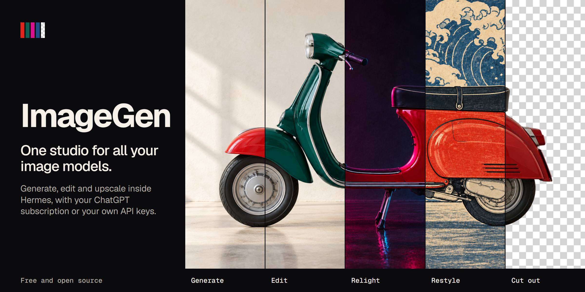
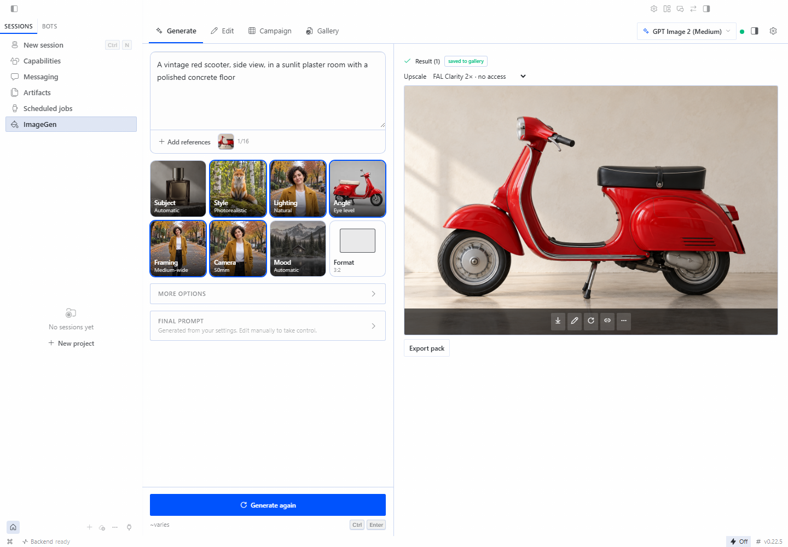
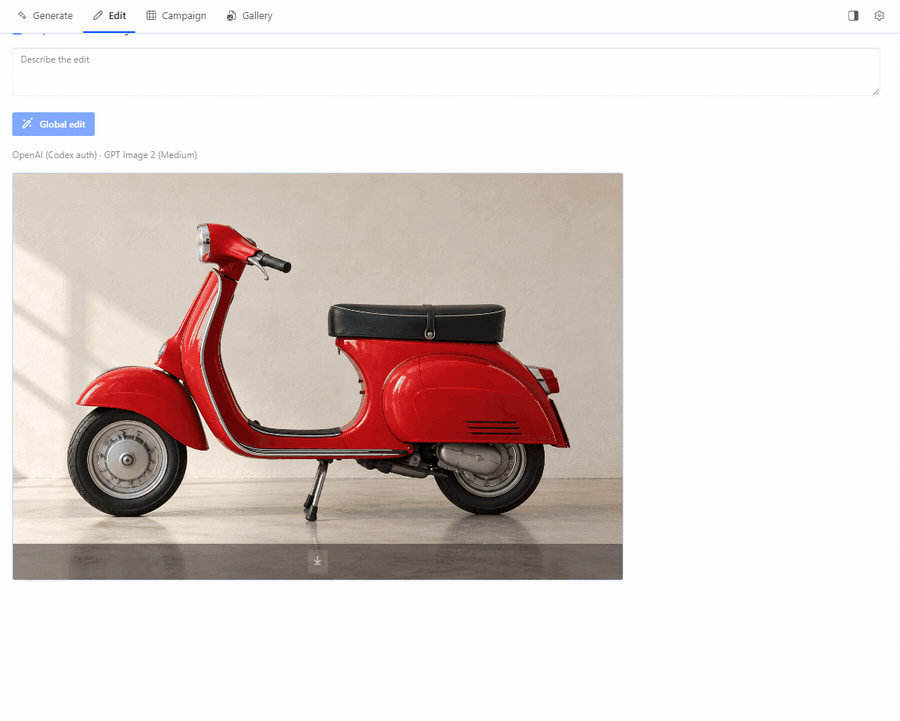
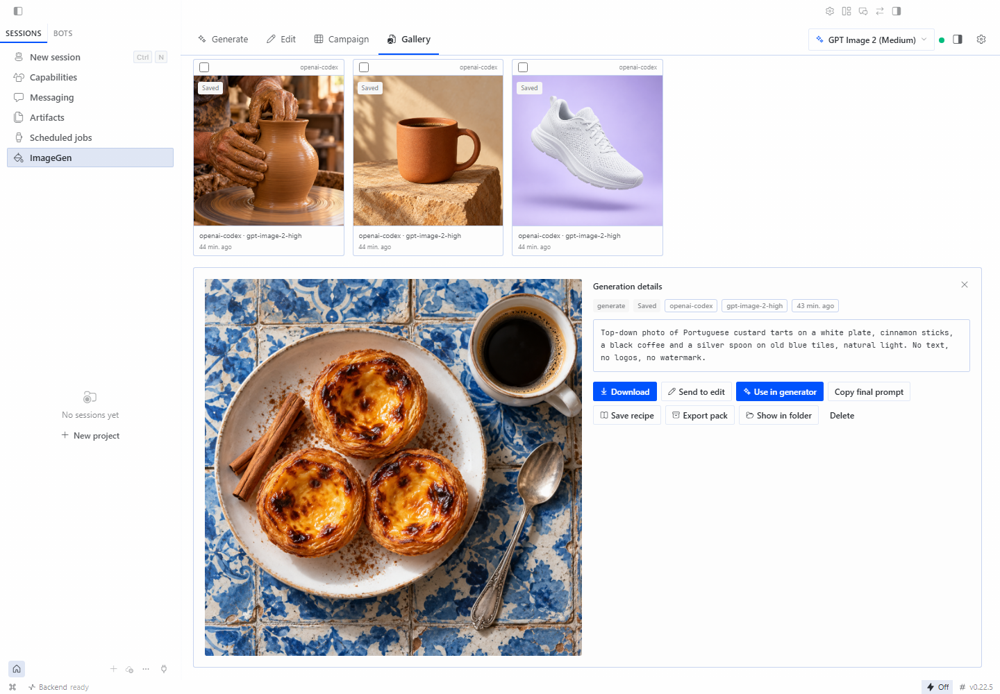

# Add ImageGen to the plugin catalog

Draft body for the catalog PR against `NousResearch/hermes-agent`. Update the
SHA, the validator output and the screenshots on the day it is opened.

---

## What it is

ImageGen is an image studio for Hermes Desktop. One screen reaches every image
provider the user's profile can use (FAL, Nous Portal, Magnific, Vertex AI and the Hermes
`image_gen` providers), with a guided prompt builder, reference-driven
composition, editing, campaign grids, a gallery with reusable recipes and a
local monthly budget. The UI follows the Hermes app language (en, pt, es, zh).

- Repo: https://github.com/phdigital01/imagegen-hermes
- Pinned SHA: `747bc6f3e6d3b6840e13c0752088119a5447a2f5`
- Version: 1.3.0, `requires_hermes: ">=0.22.5"`
- Surfaces: Desktop UI (`desktop/plugin.js`, SDK only) and a dashboard REST
  router (`dashboard/plugin_api.py`). One `image_gen` provider (`ctx.register_image_gen_provider`),
  one transcript directive (`imagegen-image`) and an on-demand workspace pane.
  No tools, hooks, middleware or commands.

## How it uses Hermes

- **Credentials:** `FAL_KEY`, `MAGNIFIC_API_KEY`, `VERTEX_API_KEY` and `VERTEX_PROJECT` are optional
  `config_schema` secrets, edited in Settings → Plugins → ImageGen and read with
  `agent.secret_scope.get_secret`. The plugin never opens or writes `.env`,
  `auth.json` or other credential files. A linked ChatGPT subscription is reached only
  through the Hermes image provider, so the plugin never holds its token.
  One point for review under rule 11: the optional command line runs outside Hermes, so its
  `--profile` option calls Hermes's own `hermes_cli.env_loader.load_hermes_dotenv` to load
  that profile's keys, as Hermes does at start. I would welcome a public route for this.
- **LLM:** prompt writing and reference reading use `ctx.llm.complete` on two
  auxiliary slots the plugin registers, `imagegen_prompt` and
  `imagegen_vision` (inherits `vision`).
- **Data:** everything it stores lives in `plugin-data/imagegen/`.

## Disclosures

- Paid requests: each generation, edit or upscale is billed by the provider
  that runs it. On the ImageGen screen every paid request starts from a user
  click. The agent can spend only after the user picks ImageGen under Tools →
  Image Generation (its `image_generate` calls then run through ImageGen and
  its budget) or registers the optional MCP server below. A local monthly budget reserves the estimated cost first and
  blocks unknown prices while a limit is set.
- Network: prompts and reference images go to the chosen provider:
  `queue.fal.run` and `fal.run` (including reference uploads),
  `api.magnific.com`, `aiplatform.googleapis.com` (Vertex AI), the Nous Portal
  tool gateway, or the Hermes image
  provider's endpoint.
- Optional MCP server: `backend/mcp_server.py` exposes generation to the agent
  only if the user adds it to `mcp_servers` by hand.
- Command line: `backend/imagegen_cli.py` runs one generation, or a parallel
  batch with `--batch`, only when someone runs it; each job is billed like a click on
  Generate. The README warns about provider and subscription limits on parallel use.
- Private host imports (rule 9 warning): to list and call the Hermes image
  providers, the Nous gateway and the FAL catalog, the plugin imports
  `agent.image_gen_registry`, `tools.managed_tool_gateway`,
  `tools.image_generation_tool` (`_build_fal_payload`,
  `_build_fal_edit_payload`, `_get_managed_fal_client`),
  `tools.tool_backend_helpers`, `hermes_cli.plugins.discover_plugins` and
  `hermes_cli.env_loader` (command line only).
  `providers_catalog.py` calls `register_provider` so bundled `image_gen`
  providers are available to the dashboard process. I would welcome public
  seams for these and can open issues for them.

## Validation

- `hermes plugins validate <clean clone> --json`: `ok: true`; all checks pass
  (manifest, `requires_hermes`, config schema, loadable entries, capability
  probe, security scan, no core override, desktop surface). One warning: the
  private imports above.
- Installed from this public repository at the pinned commit into a throwaway
  `HERMES_HOME`: `hermes plugins install phdigital01/imagegen-hermes --enable`
  succeeds and `hermes plugins list` shows it enabled at 1.3.0.
- Installed from Git into an isolated Hermes Desktop 0.22.5 (sandbox
  `HERMES_HOME`, mock model): after the Desktop UI toggle the ImageGen page
  loads, every tab renders and the gallery shows images generated through it.
  The screenshots below come from that run. The images were generated through the
  plugin on a real account and replayed in the sandbox, which holds no login.
- Backend suite on Windows 11: 170 passed, 2 skipped.

## Screenshots

